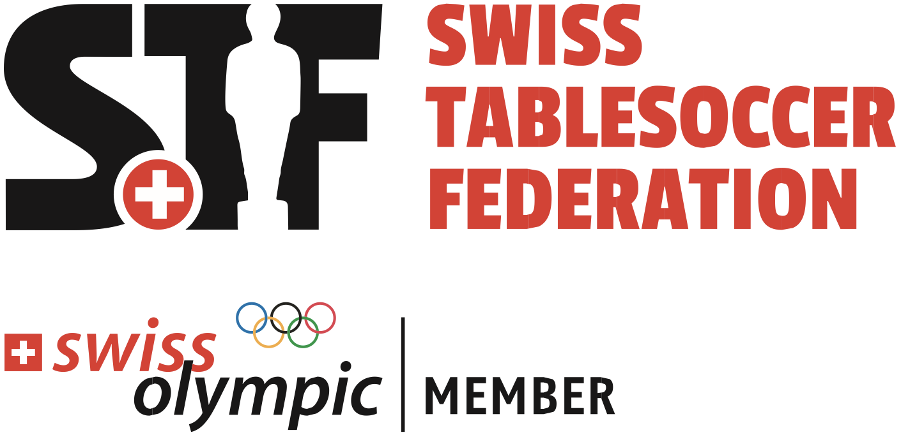

# Regolamento Qualificazione ITSF WORLD CUP

| | |
|---|---|
| Valido dal | World Cup dal 2023 |
| Modifiche | Vedere il registro delle modifiche |
| Creato il | 20 aprile 2021 |
| Creato da | Gruppo di lavoro STF Qualificazione ITSF WORLD CUP |

---

## Registro delle modifiche

| Versione | Data | Autori | Osservazioni |
|---|---|---|---|
| 2021.1 | 20.04.2021 | Gruppo di lavoro | Elaborazione del concetto su mandato dell'AD STF 2020 |
| 2021.2 | 13.06.2021 | Gruppo di lavoro | Approvazione ed entrata in vigore della versione 2021.2 da parte dell'AD STF 2021 |
| 2023.1 | 09.09.2023 | Gruppo di lavoro | Flessibilizzazione del ciclo di qualificazione ITSF secondo le direttive ITSF e la pianificazione dell'ITSF WORLD CUP 2025 |

---

## Indice

- [1. Introduzione](#1-introduzione)
- [2. Situazione di partenza](#2-situazione-di-partenza)
- [3. Condizioni di base per una qualificazione](#3-condizioni-di-base-per-una-qualificazione)
- [4. Qualificazione tramite la via ITSF](#4-qualificazione-tramite-la-via-itsf)
- [5. Qualificazione tramite la via STF (Swiss Tablesoccer Finals)](#5-qualificazione-tramite-la-via-stf-swiss-tablesoccer-finals)
  - [5.1 Assegnazione delle wildcard](#51-assegnazione-delle-wildcard)
  - [5.2 Regola dei ripescaggi](#52-regola-dei-ripescaggi)
- [6. Altre discipline](#6-altre-discipline)
  - [6.1 Doppio Classic](#61-doppio-classic)
  - [6.2 Doppio Juniores / Doppio Senior / gare per persone con disabilità e altre discipline non menzionate nel presente regolamento](#62-doppio-juniores-doppio-senior-gare-per-persone-con-disabilita-e-altre-discipline-non-menzionate-nel-presente-regolamento)
- [7. Iscrizione e disdetta presso la STF e nomine](#7-iscrizione-e-disdetta-presso-la-stf-e-nomine)
- [8. Varie](#8-varie)

---

## 1. Introduzione

Il presente documento intende definire come i giocatori e le giocatrici possano qualificarsi per il WORLD CUP della International Table Soccer Federation (ITSF) e come si svolge tale processo.

Il documento è redatto in lingua tedesca. La versione tedesca è l'originale ufficiale, sia nel contenuto che nella forma. Le versioni in altre lingue sono state realizzate mediante traduzione elettronica.

## 2. Situazione di partenza

L'ITSF assegna, per ogni ITSF WORLD CUP, un determinato numero di posti di partenza per le varie gare. Tale numero può variare da un ITSF WORLD CUP all'altro, ad esempio in funzione del numero di giocatori e giocatrici con licenza, ecc.

Oltre al numero determinato di wildcard che la Swiss Tablesoccer Federation (STF) può assegnare, è possibile qualificarsi tramite una via ITSF. Queste vie di qualificazione vengono comunicate dall'ITSF. Una qualificazione di questo tipo tramite l'ITSF – a condizione che il posto di partenza venga occupato – aumenta quindi il contingente di giocatori e giocatrici che la STF può comunicare all'ITSF.

## 3. Condizioni di base per una qualificazione

Per ogni qualificazione è condizione necessaria che sussista il diritto di partecipazione all'ITSF WORLD CUP concesso sia dall'ITSF sia dalla STF.

Tutti i giocatori e le giocatrici che si qualificano tramite l'ITSF o la STF devono inoltre gareggiare sotto la bandiera svizzera, pena la perdita del posto di partenza.

La partecipazione è possibile soltanto in un'unica categoria d'età.

## 4. Qualificazione tramite la via ITSF

Se i giocatori o le giocatrici si qualificano tramite la via ITSF, si applica quanto segue:

- La qualificazione tramite la via ITSF ha la precedenza rispetto alla via STF (Swiss Tablesoccer Finals, risp. campionati svizzeri).
- Nelle gare di doppio, i giocatori o le giocatrici devono partecipare all'ITSF WORLD CUP nella medesima formazione.
- I giocatori o le giocatrici qualificati/e tramite l'ITSF nelle gare di doppio, che non occupano tale posto di partenza, non possono qualificarsi (con un altro partner) tramite la via STF. Eccezione a questa regola: se un/a giocatore/giocatrice della squadra qualificatasi tramite la via ITSF è totalmente impossibilitato/a a partecipare all'ITSF WORLD CUP (ossia non può disputare nemmeno altre gare, inclusa la nazionale), il/la giocatore/giocatrice rimanente ha la possibilità di qualificarsi con un altro partner tramite la via STF.

## 5. Qualificazione tramite la via STF (Swiss Tablesoccer Finals)

Il numero di giocatori e giocatrici che possono qualificarsi tramite la via STF dipende dal numero di wildcard a disposizione della STF. Il numero di wildcard varia a seconda dell'ITSF WORLD CUP. L'idea è che si qualifichino almeno i campioni e le campionesse svizzeri/e degli anni compresi tra l'ultimo ITSF WORLD CUP e il prossimo ITSF WORLD CUP, nelle rispettive gare.

### 5.1 Assegnazione delle wildcard

Per le gare dell'ITSF WORLD CUP disputate agli Swiss Tablesoccer Finals (campionati svizzeri, risp. CS), i giocatori o le squadre si qualificano in base al numero di wildcard (WC) disponibili.

E precisamente secondo le seguenti disposizioni (esempio con 3 CS tra due ITSF WORLD CUP):

| | 2 WC | 3 WC | 4 WC | 5 WC | 6 WC | 7 WC ecc. |
|---|---|---|---|---|---|---|
| CS Anno 1 | – | Posizione 1 | Posizione 1 | Posizione 1 | Posizione 1+2 | Posizione 1+2 … |
| CS Anno 2 | Posizione 1 | Posizione 1 | Posizione 1 | Posizione 1+2 | Posizione 1+2 | Posizione 1+2 … |
| CS Anno 3 | Posizione 1 | Posizione 1 | Posizione 1+2 | Posizione 1+2 | Posizione 1+2 | Posizione 1-3 … |

*Legenda tabella: CS = Campionato svizzero; Anno 1 = primo anno di qualificazione, risp. il CS temporalmente più lontano dal WORLD CUP.*

*Rappresentazione grafica dell'ordine di assegnazione delle wildcard (esempio con 3 CS tra 2 WORLD CUP). (Il grafico del PDF originale non è riprodotto qui.)*

- I giocatori o le giocatrici che si qualificano nelle gare di doppio devono partecipare all'ITSF WORLD CUP nella medesima formazione, pena la perdita del posto di partenza.
- Al momento dell'iscrizione al campionato svizzero, una squadra deve decidere se, in caso di classificazione al CS imminente (Swiss Tablesoccer Finals) sufficiente per una qualificazione all'ITSF WORLD CUP, tale posto di partenza verrà occupato.
- Se una squadra decide, al momento dell'iscrizione al CS (Swiss Tablesoccer Finals), di occupare il posto di partenza, un posto di partenza ottenuto in un CS precedente nella stessa gara decade (non esiste alcun diritto di scelta/di scelta del partner).
- Qualora il/la partner di doppio si qualifichi tramite la via ITSF con un altro giocatore o un'altra giocatrice, il/la giocatore/giocatrice rimanente può qualificarsi con un altro partner tramite la via ITSF o STF, in un altro CS.
- Qualora un/a giocatore/giocatrice della squadra qualificatasi tramite la via STF fosse totalmente impossibilitato/a a partecipare all'ITSF WORLD CUP (ossia non può disputare nemmeno altre gare, inclusa la nazionale), il/la giocatore/giocatrice rimanente ha la possibilità di qualificarsi con un altro partner tramite la via STF.

### 5.2 Regola dei ripescaggi

- Giocatori, giocatrici o squadre possono qualificarsi come ripescati/e, ad esempio per i seguenti motivi:
  - Un/a giocatore/giocatrice o una squadra decide di non partecipare all'ITSF WORLD CUP oppure ne è impossibilitato/a
  - Un/a giocatore/giocatrice o una squadra si è già qualificato/a in un altro CS
  - Si liberano wildcard della STF perché giocatori/giocatrici o squadre si sono qualificati/e tramite la via ITSF.
- I ripescaggi vengono definiti, fino alla 4ª posizione inclusa, nel seguente ordine:
  1. La posizione più alta non ancora qualificata tra tutti i CS rilevanti.
  2. Per le squadre che hanno ottenuto la stessa classificazione: prima il/la meglio classificato/a del CS più recente precedente l'ITSF WC in arrivo, poi quello del CS penultimo, e così via.
- Qualora giocatori/giocatrici o squadre siano stati ripescati/e fino alla 4ª posizione inclusa di entrambi i CS e non tutte le wildcard siano ancora state assegnate, gli altri partecipanti vengono definiti mediante ulteriori ripescaggi del CS più recente, dalla 5ª all'8ª posizione inclusa, come segue:
  1. Se i posti aggiuntivi a partire dalla 5ª posizione di una gara al campionato svizzero non vengono disputati: vengono ripescati i 5ª classificati che presentano il miglior piazzamento nella classifica STF della stagione più recente (nelle gare di doppio i punti dei giocatori vengono sommati). Se il punteggio è esattamente identico, è determinante il maggior numero di vittorie stagionali STS; se anche questo è identico, decide il miglior piazzamento nel relativo ranking ITSF (anch'esso sommato nelle gare di doppio). Qualora dovessero rimanere ulteriori wildcard da assegnare, queste vengono determinate secondo il punto 8 del presente regolamento.
  2. Se i posti aggiuntivi a partire dalla 5ª posizione di una gara al campionato svizzero vengono disputati: secondo la classificazione più alta; in caso di parità: secondo quanto previsto al capoverso precedente (miglior piazzamento nella classifica STF della stagione più recente).

## 6. Altre discipline

### 6.1 Doppio Classic

Qualora le rispettive gare vengano disputate ai campionati svizzeri, giocatori, giocatrici e squadre si qualificano in base alle disposizioni sulla qualificazione di cui ai punti 4 e 5.

**Via ITSF:**

- I giocatori e le giocatrici qualificati/e tramite la via ITSF nel Doppio Classic devono partecipare all'ITSF WORLD CUP nella medesima formazione.
- I giocatori e le giocatrici qualificati/e tramite la via ITSF nel Doppio Classic che non partecipano in tale formazione all'ITSF WORLD CUP per la gara corrispondente, non possono partecipare nemmeno qualora si fossero (inoltre) qualificati/e tramite la via STF (con un altro partner). Unica eccezione è il caso in cui un/a giocatore/giocatrice della squadra qualificatasi tramite l'ITSF sia totalmente impossibilitato/a a partecipare all'ITSF WORLD CUP (ossia non può disputare nemmeno altre gare, inclusa la nazionale): in tal caso il/la giocatore/giocatrice rimanente ha la possibilità di qualificarsi con un altro partner tramite la via STF.
- Qualora un/a giocatore/giocatrice della squadra qualificatasi tramite la via ITSF sia totalmente impossibilitato/a a partecipare all'ITSF WORLD CUP (ossia non può disputare nemmeno altre gare, inclusa la nazionale), il/la giocatore/giocatrice rimanente ha la possibilità di qualificarsi con un altro partner tramite la via STF.

**Via STF:**

- La qualificazione tramite la via STF avviene in base ai risultati ottenuti ai CS nelle discipline Doppio Donne e Doppio Uomini. A seconda del numero di wildcard, i giocatori e le giocatrici si qualificano secondo la tabella seguente:

| | 2 WC | 3 WC | 4 WC | 5 WC | 6 WC | 7 WC ecc. |
|---|---|---|---|---|---|---|
| CS Anno 1 | – | Posizione 1 | Posizione 1 | Posizione 1 | Posizione 1+2 | Posizione 1+2 … |
| CS Anno 2 | Posizione 1 | Posizione 1 | Posizione 1 | Posizione 1+2 | Posizione 1+2 | Posizione 1+2 … |
| CS Anno 3 | Posizione 1 | Posizione 1 | Posizione 1+2 | Posizione 1+2 | Posizione 1+2 | Posizione 1-3 … |

*Legenda tabella: CS = Campionato svizzero; Anno 1 = primo anno di qualificazione, risp. il CS temporalmente più lontano dal WORLD CUP.*

- Le squadre che si sono qualificate tramite la via STF hanno facoltà di scegliere se disputare, nella medesima formazione, anche la disciplina Doppio Classic.
- Al momento dell'iscrizione al campionato svizzero, una squadra deve decidere se, in caso di classificazione al CS imminente sufficiente per una qualificazione all'ITSF WORLD CUP, tale posto di partenza verrà occupato.
- Se una squadra decide, al momento dell'iscrizione al CS, di occupare il posto di partenza, un posto di partenza ottenuto in un CS precedente nella stessa gara decade (non esiste alcun diritto di scelta/di scelta del partner).
- Qualora il/la partner di doppio si qualifichi tramite la via ITSF con un altro giocatore o un'altra giocatrice, il/la giocatore/giocatrice rimanente può qualificarsi con un altro partner tramite la via ITSF o STF, in un altro CS.
- Se una squadra decide, al momento dell'iscrizione al CS, di occupare il posto di partenza, un posto di partenza ottenuto in un CS precedente nella stessa gara decade (non esiste alcun diritto di scelta/di scelta del partner). Unica eccezione è il caso in cui un/a giocatore/giocatrice della squadra qualificatasi tramite la via STF sia totalmente impossibilitato/a a partecipare all'ITSF WORLD CUP (ossia non può disputare nemmeno altre gare, inclusa la nazionale): in tal caso il/la giocatore/giocatrice rimanente ha la possibilità di qualificarsi con un altro partner tramite la via STF.
- Le squadre devono decidere entro il termine previsto al punto 7. Se le squadre interessate rinunciano a partecipare alla disciplina Doppio Classic, oppure se restano ulteriori posti di partenza da assegnare, i partecipanti vengono definiti secondo il punto 8.

### 6.2 Doppio Juniores / Doppio Senior / gare per persone con disabilità e altre discipline non menzionate nel presente regolamento

- Qualora le rispettive gare vengano disputate agli Swiss Tablesoccer Finals (campionati svizzeri), giocatori, giocatrici e squadre si qualificano in base alle disposizioni sulla qualificazione di cui ai punti 4 e 5.
- Qualora le rispettive gare non vengano disputate agli Swiss Tablesoccer Finals (campionati svizzeri), le wildcard vengono assegnate secondo il punto 8.

## 7. Iscrizione e disdetta presso la STF e nomine

Al termine dell'ultimo CS del periodo di qualificazione, il/la giocatore/giocatrice o la squadra dispone, fino al termine comunicato dalla STF al momento opportuno, del tempo necessario per iscriversi o disdire definitivamente la propria partecipazione all'ITSF WORLD CUP per ciascuna gara.

È responsabilità dei giocatori/delle giocatrici o delle squadre iscriversi o disdire in modo vincolante entro tale termine. Se il termine per l'iscrizione/disdetta viene mancato, i posti di partenza decadono e subentrano i rispettivi giocatori/giocatrici o squadre secondo il punto 5.2, "Regola dei ripescaggi". Qualora fossero ancora disponibili ulteriori wildcard, queste vengono assegnate secondo il punto 8.

Le rinunce a breve termine, successive alla nomina definitiva (di norma circa 30 giorni dopo l'ultimo CS disputato prima dell'ITSF WORLD CUP), sono disciplinate secondo il punto 8.

La STF comunica le nomine all'ITSF.

## 8. Varie

Per le situazioni espressamente menzionate e per ulteriori costellazioni che dovessero presentarsi e che non sono disciplinate dal presente regolamento, oppure in caso di modifiche a breve termine inevitabili, decide il comitato direttivo della STF in merito alle modalità da seguire e a chi vengono assegnati eventuali posti (residui).

A tale scopo, il comitato direttivo della STF può designare un organo (ad es. la commissione sportiva) o una persona (ad es. il/la responsabile del settore Sport agonistico della STF) incaricato/a di tale compito.
