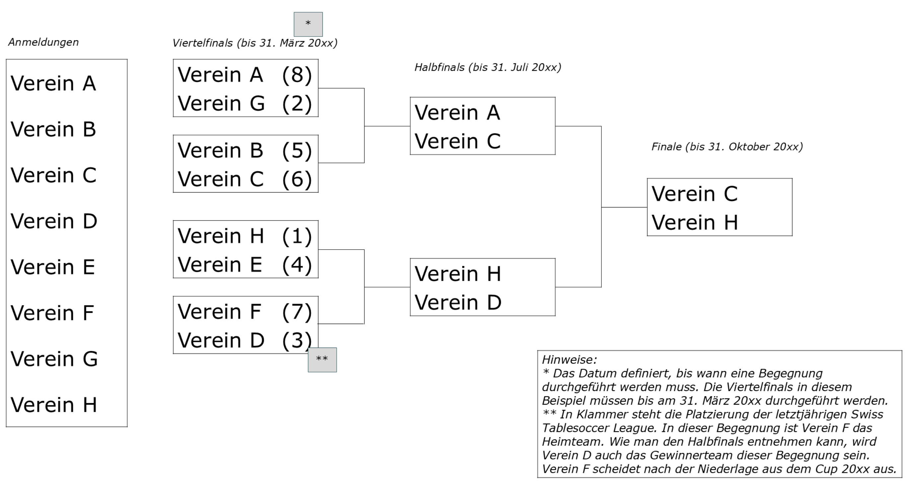

# Reglement - Swiss Tablesoccer Cup

| | |
|---|---|
| Gültig ab | 01.01.2026 |
| Anpassungen | Gemäss Änderungsverzeichnis |
| Erstellt am | April 2025 |
| Erstellt durch | Hannes Wallimann, Cyril Amez und Esther Mahnig |

*Das vorliegende Dokument ist in deutscher Sprache verfasst. Die deutsche Fassung gilt als Original in Wort und Schrift. Versionen in anderen Sprachen wurden teilweise mittels elektronischer Übersetzung erstellt.*

---

## Änderungsverzeichnis

| Version | Datum | Autoren | Bemerkungen |
|---|---|---|---|
| 2026.1 | 01.01.2026 | H. Wallimann | Erstveröffentlichung und Inkraftsetzung |

---

## Inhaltsverzeichnis

- [Allgemeinde Ordnung](#allgemeinde-ordnung)
  - [1. Lizenz](#1-lizenz)
  - [2. Finanzielle Verpflichtungen](#2-finanzielle-verpflichtungen)
  - [3. Mannschaftsname](#3-mannschaftsname)
  - [4. Titel und Preise](#4-titel-und-preise)
  - [5. Schadenersatzansprüche gegen die STF](#5-schadenersatzanspruche-gegen-die-stf)
  - [6. Salvatorische Klausel](#6-salvatorische-klausel)
- [Spielordnung](#spielordnung)
  - [1. Modus](#1-modus)
  - [2. Mannschaftsmeldung](#2-mannschaftsmeldung)
  - [3. Tischwahl](#3-tischwahl)
  - [4. Spielstätte](#4-spielstatte)
  - [5. Heimteam](#5-heimteam)
  - [6. Schiedsrichter](#6-schiedsrichter)

---

## Allgemeinde Ordnung

### 1. Lizenz

**1.1** Am Wettbewerb können nur jene Vereine Mannschaften melden, denen zuvor von der Swiss Tablesoccer Federation eine Lizenz erteilt wurde.

**1.2** Jeder Verein darf eine Mannschaft melden.

**1.3** Spielende dürfen während einem Jahr nur für einen Verein spielen. D.h. Spielende dürfen nicht für unterschiedliche Vereine am Cup und an der Swiss Tablesoccer League antreten.

### 2. Finanzielle Verpflichtungen

**2.1** Die Teilnahmegebühr beträgt CHF 50 pro gemeldete Mannschaft und beinhaltet auch Lizenzkosten. Die Rechnung wird nach Anmeldeschluss für die Tablesoccer League zugesendet und ist innert 20 Tagen zu zahlen.

**2.2** Bei Nichtantreten einer gemeldeten Mannschaft werden die Teilnahmegebühr nicht zurückerstattet.

### 3. Mannschaftsname

**3.1** Der Mannschaftsname muss mit dem Vereinsnamen, welcher der Lizenzgeber der Mannschaft ist, im Zusammenhang stehen. Es darf höchstens ein Sponsor im Namen genannt werden (z. B. TFC Stadt Adidas). Der Mannschaftsname darf während der Saison nicht geändert werden, Ausnahmen sind Sponsoren, welche in den Teamnamen integriert werden.

### 4. Titel und Preise

**4.1** Das Gewinnerteam darf sich "Cupsieger Swiss Tablesoccer Cup im Jahr 20xx" nennen.

**4.2** Es wird kein Preisgeld ausgeschüttet.

### 5. Schadenersatzansprüche gegen die STF

**5.1** Schadenersatzansprüche gegen die STF, ihre Organe und das Schiedsgericht wegen ihres Handelns aufgrund der vorliegenden Statuten und der sonstigen Ordnungen und Bestimmungen der STF sind ausgeschlossen, es sei denn, ein Lizenznehmer oder ein/e Sportler/in weist nach, dass die Schädigung vorsätzlich oder grob fahrlässig erfolgt ist, sowie dass der Verein oder der/die Sportler/in sämtliche Rechtsbehelfe zur Abwendung des Schadens ergriffen haben und der Geschädigte nicht anderweitig Schadenersatz erlangen kann.

### 6. Salvatorische Klausel

**6.1** Die Unwirksamkeit einzelner Bestimmungen dieser Ordnung hat nicht die Unwirksamkeit der gesamten Ordnung zur Folge.

## Spielordnung

### 1. Modus

**1.1** Der Cup wird in KO-Runden gespielt. Es gibt keine Setzung.

**1.2** Die Begegnungen werden nach der Anmeldefrist zufällig ausgelost und ein Turnierbaum wird erstellt (siehe Abbildung 1).

**1.3** Die einzelnen Begegnungen müssen bis zu einer bestimmten Deadline durchgeführt werden (siehe Abbildung 1). Für die Koordination (z. B. Festlegung des Datums) einer Begegnung sind die beiden Vereine einer Begegnung verantwortlich.

**1.4** Als Modus wird derjenige der Swiss Tablesoccer League empfohlen.[^1] Im gegenseitigen Einverständnis darf vom vorgegebenen Modus abgewichen werden (z. B. es wird ein Best-of-3 des STL-Moduses gespielt).

**1.5** Nach der Begegnung muss das Siegerteam sowie die eingesetzten Spielenden gemeldet werden.

**1.6** Findet eine Begegnung nicht statt, scheiden beide Vereine aus dem Cup aus.

[^1]: Das Reglement ist hier abgespeichert: [Reglement Swiss Tablesoccer League](/documents/?doc=reglement-swiss-tablesoccer-league-de.md).

### 2. Mannschaftsmeldung

**2.1** Jede Mannschaft meldet im Cup mindestens 6 Spielende. Der Verein ist dafür verantwortlich, eine allfällige Meldung auf der STF-Homepage zu prüfen.

**2.2** In begründeten Fällen dürfen Spielende nach der Anmeldefrist nachgemeldet werden. Der Entscheid fällt das Organisationskomitee.

### 3. Tischwahl

**3.1** Vor der Begegnung müssen sich die beiden Vereine auf die Tischmodelle einigen. Erlaubt sind alle ITSF-Tischmodelle inkl. Ullrich. Falls eine Einigung nicht möglich ist, darf das Heimteam sich für das Tischmodell entscheiden.

**3.2** Auf den Tischen wird der vom jeweiligen Tischhersteller für seine Tische vorgesehene (von ITSF definierte) offizielle Ball gespielt. Die eingesetzten Bälle haben in einem neuwertigen Zustand zu sein.

### 4. Spielstätte

**4.1** Das Heimteam ist in der Verantwortung, eine Spielstätte zu definieren (z. B. Clublokal, auswärtiger Spielort).

### 5. Heimteam

**5.1** Heimteam ist der schlechterplatzierte Verein der letztjährigen Swiss Tablesoccer League.

### 6. Schiedsrichter

**6.1** Von der STF werden keine Referees zur Verfügung gestellt. Es ist jedoch gestattet, die Schiedsrichterfrage bilateral zu lösen.
