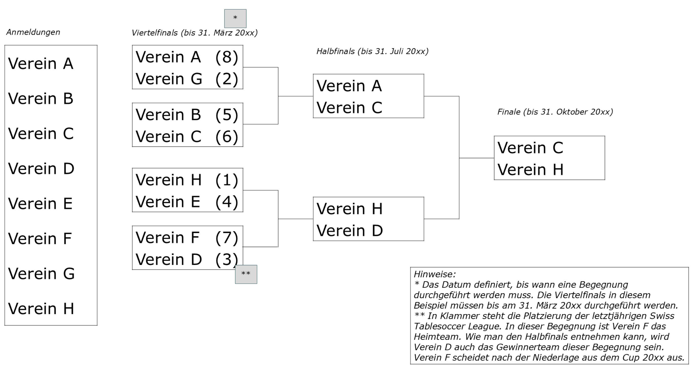

# Regulations - Swiss Tablesoccer Cup

| | |
|---|---|
| Valid from | 01.01.2026 |
| Amendments | See change log |
| Created on | April 2025 |
| Created by | Hannes Wallimann, Cyril Amez and Esther Mahnig |

*This document is drafted in German. The German version is the authoritative original, both in wording and in form. Versions in other languages were partly produced by machine translation.*

---

## Change Log

| Version | Date | Authors | Remarks |
|---|---|---|---|
| 2026.1 | 01.01.2026 | H. Wallimann | Initial publication and entry into force |

---

## Table of Contents

- [General Regulations](#general-regulations)
  - [1. License](#1-license)
  - [2. Financial Obligations](#2-financial-obligations)
  - [3. Team Name](#3-team-name)
  - [4. Title and Prizes](#4-title-and-prizes)
  - [5. Claims for Damages Against the STF](#5-claims-for-damages-against-the-stf)
  - [6. Severability Clause](#6-severability-clause)
- [Match Regulations](#match-regulations)
  - [1. Format](#1-format)
  - [2. Team Registration](#2-team-registration)
  - [3. Table Selection](#3-table-selection)
  - [4. Venue](#4-venue)
  - [5. Home Team](#5-home-team)
  - [6. Referees](#6-referees)

---

## General Regulations

### 1. License

**1.1** Only clubs that have previously been granted a license by the Swiss Tablesoccer Federation may enter teams in the competition.

**1.2** Each club may enter one team.

**1.3** Players may only play for one club within a given year. This means players may not compete for different clubs in the Cup and in the Swiss Tablesoccer League.

### 2. Financial Obligations

**2.1** The participation fee is CHF 50 per registered team and also covers the license fee. The invoice will be sent after the registration deadline for the Tablesoccer League and is payable within 20 days.

**2.2** If a registered team fails to compete, the participation fee will not be refunded.

### 3. Team Name

**3.1** The team name must be connected to the name of the club holding the license for the team. At most one sponsor may be named within the team name (e.g., TFC City Adidas). The team name may not be changed during the season, except for sponsors being integrated into the team name.

### 4. Title and Prizes

**4.1** The winning team may call itself "Swiss Tablesoccer Cup Champion 20xx".

**4.2** No prize money will be awarded.

### 5. Claims for Damages Against the STF

**5.1** Claims for damages against the STF, its bodies, and the arbitration tribunal arising from their actions under the present statutes and the other regulations and provisions of the STF are excluded, unless a license holder or an athlete proves that the damage was caused intentionally or through gross negligence, that the club or the athlete took all available legal remedies to avert the damage, and that the injured party cannot otherwise obtain compensation.

### 6. Severability Clause

**6.1** The invalidity of individual provisions of these regulations does not result in the invalidity of the regulations as a whole.

## Match Regulations

### 1. Format

**1.1** The Cup is played in knockout rounds. There is no seeding.

**1.2** The fixtures are drawn at random after the registration deadline, and a tournament bracket is created (see Figure 1).

**1.3** Each fixture must be played by a specific deadline (see Figure 1). The two clubs involved in a fixture are responsible for coordinating it (e.g., setting the date).

**1.4** The format of the Swiss Tablesoccer League is recommended.[^1] By mutual agreement, the clubs may deviate from the prescribed format (e.g., playing a best-of-3 of the STL format).

**1.5** After the fixture, the winning team and the players who took part must be reported.

**1.6** If a fixture does not take place, both clubs are eliminated from the Cup.

[^1]: The regulations are available here: [Swiss Tablesoccer League Regulations](/documents/?doc=reglement-swiss-tablesoccer-league-en.md).

### 2. Team Registration

**2.1** Each team must register at least 6 players for the Cup. The club is responsible for checking the registration on the STF website.

**2.2** In justified cases, players may be added after the registration deadline. The decision is made by the organizing committee.

### 3. Table Selection

**3.1** Before the fixture, the two clubs must agree on the table model. All ITSF table models, including Ullrich, are permitted. If no agreement can be reached, the home team may choose the table model.

**3.2** The tables are played with the official ball specified by the respective table manufacturer (as defined by the ITSF). The balls used must be in like-new condition.

### 4. Venue

**4.1** The home team is responsible for defining a venue (e.g., club premises, an away venue).

### 5. Home Team

**5.1** The home team is the lower-placed club from the previous year's Swiss Tablesoccer League.

### 6. Referees

**6.1** No referees are provided by the STF. However, the clubs are permitted to resolve the question of refereeing bilaterally.
