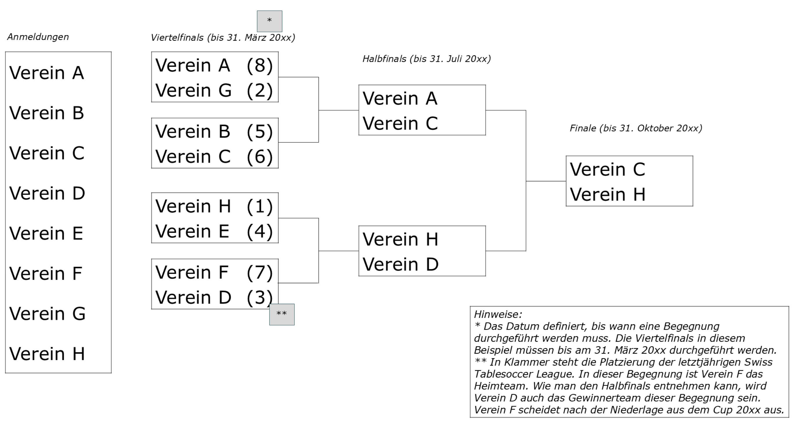

# Règlement - Swiss Tablesoccer Cup

| | |
|---|---|
| Valable à partir du | 01.01.2026 |
| Modifications | Voir le registre des modifications |
| Créé le | avril 2025 |
| Créé par | Hannes Wallimann, Cyril Amez et Esther Mahnig |

*Ce document est rédigé en langue allemande. La version allemande fait foi en tant qu'originale, tant sur le fond que sur la forme.*

---

## Registre des modifications

| Version | Date | Auteurs | Remarques |
|---|---|---|---|
| 2026.1 | 01.01.2026 | H. Wallimann | Première publication et entrée en vigueur |

---

## Table des matières

- [Règlement général](#reglement-general)
  - [1. Licences](#1-licences)
  - [2. Obligations financières](#2-obligations-financieres)
  - [3. Nom de l'équipe](#3-nom-de-lequipe)
  - [4. Titre et récompenses](#4-titre-et-recompenses)
  - [5. Demandes de dommages-intérêts à l'encontre de la STF](#5-demandes-de-dommages-interets-a-lencontre-de-la-stf)
  - [6. Clause de sauvegarde](#6-clause-de-sauvegarde)
- [Règlement de jeu](#reglement-de-jeu)
  - [1. Format](#1-format)
  - [2. Inscription des équipes](#2-inscription-des-equipes)
  - [3. Choix de la table](#3-choix-de-la-table)
  - [4. Lieu des rencontres](#4-lieu-des-rencontres)
  - [5. Équipe à domicile](#5-equipe-a-domicile)
  - [6. Arbitres](#6-arbitres)

---

## Règlement général

### 1. Licences

**1.1** Seuls les clubs ayant obtenu une licence délivrée par la Swiss Tablesoccer Federation peuvent inscrire une équipe au tournoi.

**1.2** Chaque club ne peut inscrire qu'une seule équipe.

**1.3** Les joueurs et joueuses ne peuvent jouer que pour un seul club au cours d'une même année. Cela signifie qu'ils/elles ne peuvent pas jouer pour différents clubs dans la Swiss Tablesoccer League et la Swiss Tablesoccer Cup.

### 2. Obligations financières

**2.1** Les frais de participation s'élèvent à CHF 50 par équipe inscrite, ce montant inclut également les frais de licence. La facture sera envoyée aux clubs dès la clôture des inscriptions à la Tablesoccer League et devra être payée dans un délai de 20 jours.

**2.2** En cas de non-participation d'une équipe inscrite, les frais de participation ne seront pas remboursés.

### 3. Nom de l'équipe

**3.1** Le nom de l'équipe doit être lié au nom du club détenteur de la licence. Un seul sponsor peut figurer dans le nom de l'équipe (par exemple : TFC Ville Adidas). Le nom de l'équipe ne peut être modifié en cours de saison, sauf pour intégrer un sponsor.

### 4. Titre et récompenses

**4.1** L'équipe gagnante pourra se désigner comme « Vainqueur de la Swiss Tablesoccer Cup de l'année 20xx ».

**4.2** Aucune récompense financière ne sera attribuée.

### 5. Demandes de dommages-intérêts à l'encontre de la STF

**5.1** Toute demande de dommages-intérêts à l'encontre de la STF, de ses organes ou du tribunal arbitral, en lien avec l'application des statuts présents ou d'autres règlements et dispositions de la STF, est exclue, sauf si un titulaire de licence ou un(e) sportif(ve) peut prouver que le dommage a été causé intentionnellement ou par négligence grave, que tous les recours juridiques ont été épuisés, et qu'aucune autre compensation n'est possible.

### 6. Clause de sauvegarde

**6.1** L'invalidité de certaines dispositions du présent règlement n'entraîne pas l'invalidité du règlement dans son ensemble.

## Règlement de jeu

### 1. Format

**1.1** La Coupe se joue en rounds à élimination directe. Il n'y a pas de têtes de série.

**1.2** Les rencontres sont tirées au sort après la clôture des inscriptions, puis un tableau de tournoi est établi (voir image 1 ci-dessous).

**1.3** Chaque rencontre doit être jouée avant une date limite précise (voir image 1). La coordination (par exemple : fixer la date) de chaque rencontre relève de la responsabilité des deux clubs concernés.

**1.4** Le format recommandé est celui de la Swiss Tablesoccer League.[^1] D'un commun accord, il est possible de s'écarter du format standard (par exemple : jouer un Best-of-3 selon le format STL).

**1.5** Après chaque rencontre, l'équipe gagnante ainsi que les joueurs/joueuses ayant participé doivent être communiqués.

**1.6** Si une rencontre n'a pas lieu, les deux clubs sont éliminés de la Coupe.

[^1]: Le règlement est disponible ici : [Règlement Swiss Tablesoccer League](/documents/?doc=reglement-swiss-tablesoccer-league-fr.md).

### 2. Inscription des équipes

**2.1** Chaque équipe doit inscrire au moins 6 joueurs/joueuses pour la Coupe. Le club est responsable de vérifier l'exactitude de l'inscription sur le site de la STF.

**2.2** Dans des cas justifiés, il est possible d'ajouter des joueurs/joueuses après la date limite. La décision revient au comité d'organisation.

### 3. Choix de la table

**3.1** Avant la rencontre, les deux clubs doivent s'entendre sur le modèle de table à utiliser. Tous les modèles homologués par l'ITSF, y compris Ullrich, sont autorisés. En cas de désaccord, l'équipe recevant choisit le modèle.

**3.2** Les balles utilisées doivent être celles prévues officiellement par le fabricant de la table (définies par l'ITSF), et être en parfait état.

### 4. Lieu des rencontres

**4.1** L'équipe à domicile est responsable de désigner un lieu de jeu (par exemple : local du club, lieu de jeu extérieur).

### 5. Équipe à domicile

**5.1** L'équipe la moins bien classée de la Swiss Tablesoccer League de l'année précédente est considérée comme l'équipe à domicile.

### 6. Arbitres

**6.1** Aucun arbitre ne sera désigné par la STF. Les clubs peuvent convenir entre eux de la question de l'arbitrage.
