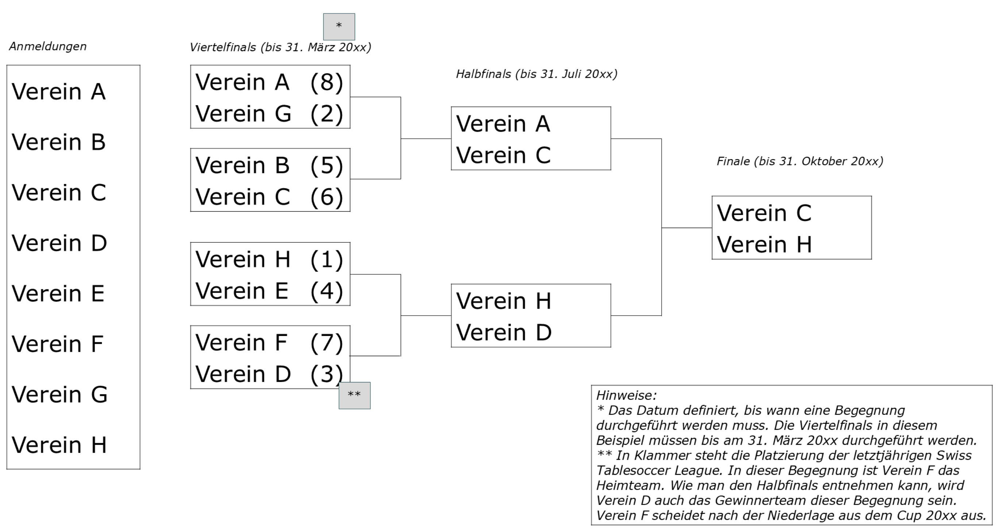

# Regolamento - Swiss Tablesoccer Cup

| | |
|---|---|
| Valido dal | 01.01.2026 |
| Modifiche | Vedere il registro delle modifiche |
| Creato il | aprile 2025 |
| Creato da | Hannes Wallimann, Cyril Amez e Esther Mahnig |

*Il presente documento è redatto in lingua tedesca. La versione tedesca è l'originale ufficiale. Le traduzioni in altre lingue sono state realizzate in parte con strumenti elettronici.*

---

## Registro delle modifiche

| Versione | Data | Autori | Osservazioni |
|---|---|---|---|
| 2026.1 | 01.01.2026 | H. Wallimann | Prima pubblicazione ed entrata in vigore |

---

## Indice

- [Disposizioni generali](#disposizioni-generali)
  - [1. Licenza](#1-licenza)
  - [2. Obblighi finanziari](#2-obblighi-finanziari)
  - [3. Nome della squadra](#3-nome-della-squadra)
  - [4. Titoli e premi](#4-titoli-e-premi)
  - [5. Richieste di risarcimento](#5-richieste-di-risarcimento)
  - [6. Clausola salvatoria](#6-clausola-salvatoria)
- [Regole di gioco](#regole-di-gioco)
  - [1. Formula](#1-formula)
  - [2. Iscrizione della squadra](#2-iscrizione-della-squadra)
  - [3. Scelta del tavolo](#3-scelta-del-tavolo)
  - [4. Sede della partita](#4-sede-della-partita)
  - [5. Determinazione della squadra di casa](#5-determinazione-della-squadra-di-casa)
  - [6. Arbitro](#6-arbitro)

---

## Disposizioni generali

### 1. Licenza

**1.1** Solo i club in possesso di una licenza rilasciata dalla Federazione Svizzera di Calcio a Tavola (STF) possono iscrivere squadre alla competizione.

**1.2** Ogni club può iscrivere una sola squadra.

**1.3** I giocatori possono rappresentare un solo club all'anno. Non è consentito partecipare con club diversi sia nella Coppa che nella Swiss Tablesoccer League.

### 2. Obblighi finanziari

**2.1** La quota di partecipazione è di 50 franchi svizzeri per squadra, inclusi i costi della licenza. La fattura sarà inviata dopo la chiusura delle iscrizioni alla Swiss Tablesoccer League e dovrà essere saldata entro 20 giorni.

**2.2** In caso di mancata partecipazione della squadra iscritta, la quota non sarà rimborsata.

### 3. Nome della squadra

**3.1** Il nome della squadra deve essere coerente con quello del club licenziatario. È ammesso un solo sponsor nel nome della squadra (esempio: TFC Stadt Adidas). Il nome della squadra non può essere modificato durante la stagione, salvo integrazione di sponsor.

### 4. Titoli e premi

**4.1** La squadra vincitrice avrà diritto a definirsi "Vincitrice della Coppa Svizzera di Calcio a Tavola dell'anno 20xx".

**4.2** Non sono previsti premi in denaro.

### 5. Richieste di risarcimento

**5.1** Le richieste di risarcimento contro la STF, i suoi organi e il tribunale arbitrale per azioni basate sul presente regolamento e su altri regolamenti STF sono escluse, a meno che non si dimostri dolo o grave negligenza e che siano stati adottati tutti i mezzi legali per evitare il danno.

### 6. Clausola salvatoria

**6.1** L'invalidità di singole disposizioni non compromette la validità dell'intero regolamento.

## Regole di gioco

### 1. Formula

**1.1** Il torneo si svolge in turni a eliminazione diretta (KO). Non esiste una classifica iniziale (nessuna testa di serie).

**1.2** Le partite vengono sorteggiate casualmente dopo la chiusura delle iscrizioni e inserite in un tabellone (vedi Figura 1).

**1.3** Le partite devono essere giocate entro le scadenze indicate. I due club sono responsabili di concordare la data della partita.

**1.4** È consigliata la modalità di gioco della [Swiss Tablesoccer League](/documents/?doc=reglement-swiss-tablesoccer-league-it.md). Tuttavia, con accordo reciproco, è possibile modificarla (es. formato Best-of-3).

**1.5** Al termine della partita, è obbligatorio segnalare la squadra vincente e i giocatori utilizzati.

**1.6** Se una partita non si disputa, entrambi i club vengono eliminati.

### 2. Iscrizione della squadra

**2.1** Ogni squadra deve iscrivere almeno 6 giocatori per la Coppa. Il club è responsabile della corretta registrazione sulla homepage della STF.

**2.2** In casi giustificati, è possibile aggiungere giocatori dopo la scadenza delle iscrizioni, previa approvazione del comitato organizzatore.

### 3. Scelta del tavolo

**3.1** I club devono concordare il modello di tavolo prima della partita. Sono ammessi tutti i modelli ITSF, inclusi i tavoli Ullrich. In caso di mancato accordo, il modello viene scelto dalla squadra di casa.

**3.2** Si deve giocare con la palla ufficiale ITSF, fornita dal produttore del tavolo e in perfette condizioni.

### 4. Sede della partita

**4.1** La squadra di casa definisce la sede (es. locale del club).

### 5. Determinazione della squadra di casa

**5.1** È considerata squadra di casa quella peggio classificata nella scorsa edizione della Swiss Tablesoccer League.

### 6. Arbitro

**6.1** La STF non fornisce arbitri. Le squadre possono accordarsi bilateralmente per l'eventuale presenza di un arbitro.
